# Thesis App
- Mobile app intended for android use for our high-school senior thesis
- Uses Ionic with capacitor to build onto android (ios not setup)
- Won State level in the Samsung Solve for Tomorrow event, winning $6,500 for our school
- Youtube video that showcases each item of the smart-home, and what we submitted for the project: 

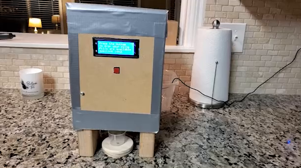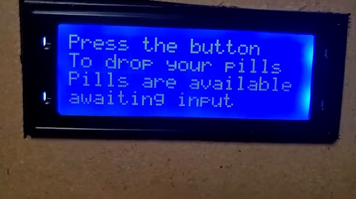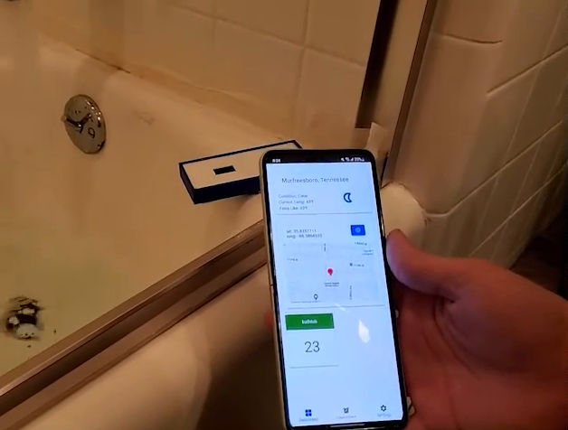

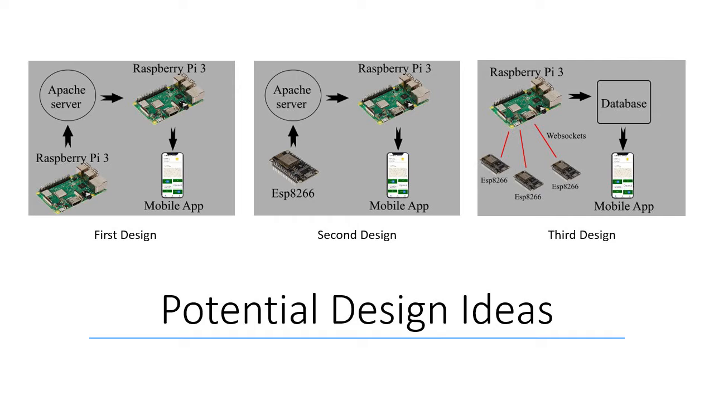

- Parts not shown in the repo:
- each module's code
- server-side code

pages:
- Fully featured login page that interacts with php api (not in repo)
   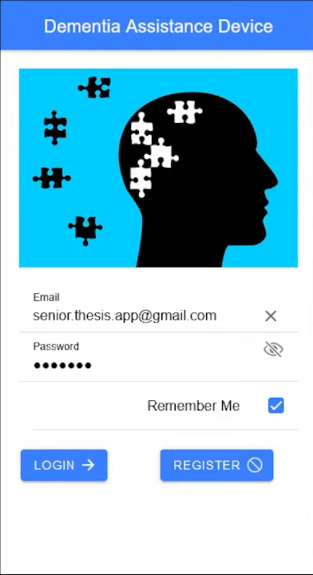
- Caching of all information (including login)
- Dashboard that has map widget, weather information, and status of all smart home modules
   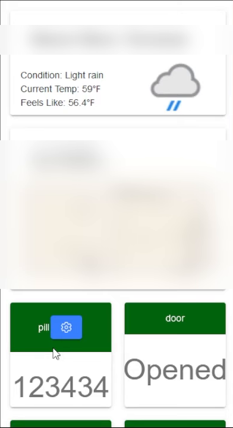
- Reminders page that communicated with the server to set reminders
   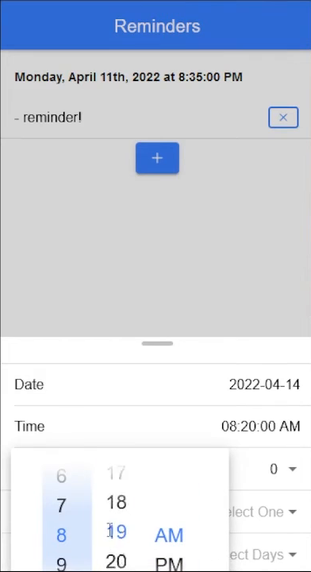
- Settings page that has a ton of different individual pages
   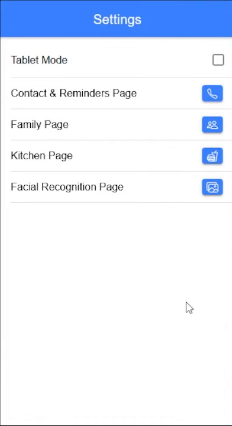
  - Ability to add contact information
     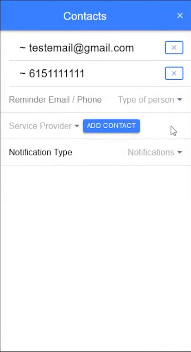
  - Family Page
     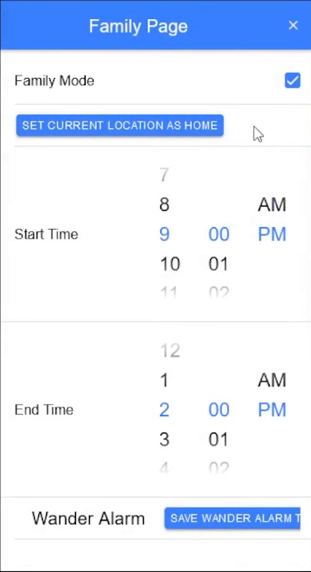
  - Facial Recognition utilizing the face-api.min.js library (hosted on server, not in repo) 
     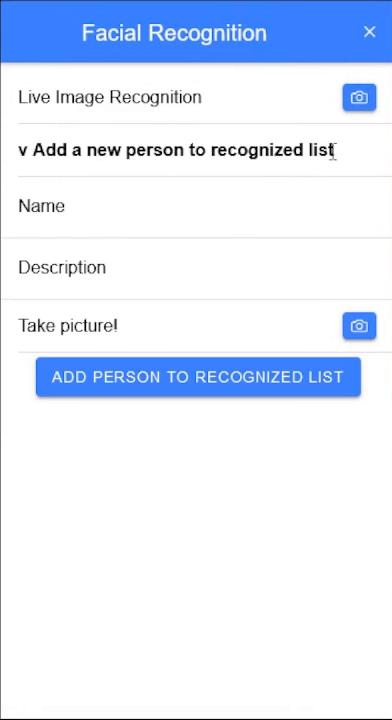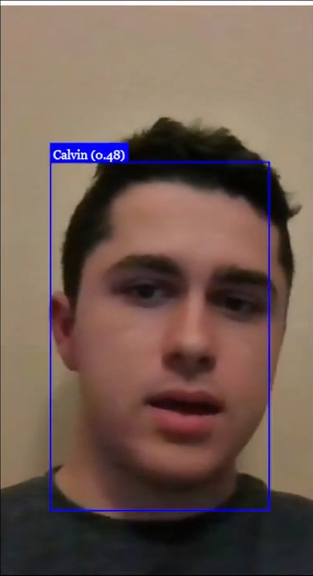
